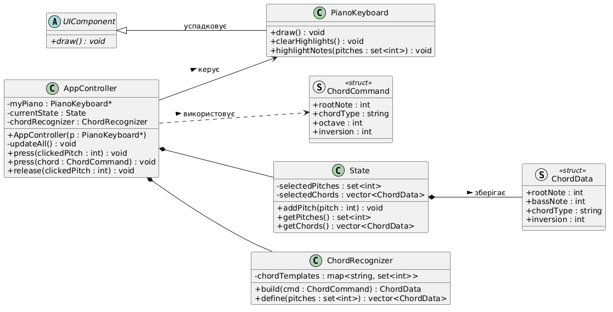
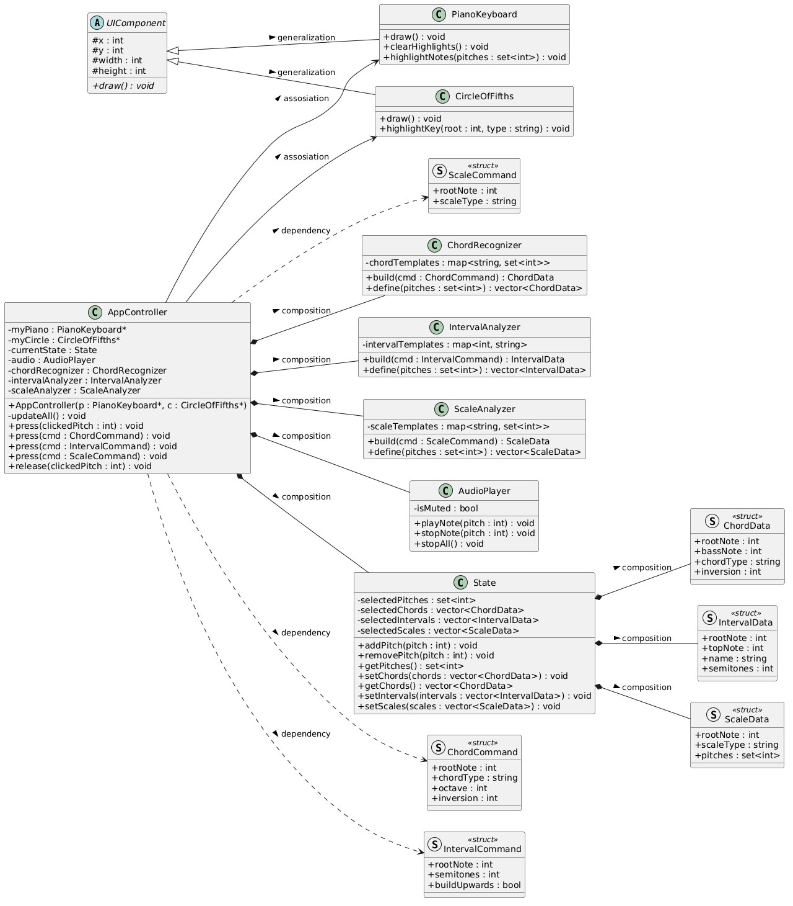

# Project_notesRecognising

Проект "Навчальна програма з музичної теорії"

На даний момент у форматі проекту частково виконано такі вимоги до лабораторної 1:
Класів: 5 (планується на даний момент: 8)
Полів: 6 (планується на даний момент: >15)
Нетривіальних методів: 9 (планується на даний момент: >20)
Ієрархій успадкування: 1 (планується на даний момент: 1)
Випадків статичного поліморфізму: 2 (планується на даний момент: >6)
Випадків динамічного поліморфізму: 1 (на даний момент лише формально) (планується на даний момент: 4>)

Деталі архітектури: проект побудований за принципом MVC : Model - State, View - UIComponent, Controller - Controller. Поточна стадія: MVP, розпізнавання акордів з нот, побудова акордів.

UML-діаграма реалізованої на даний момент архітектури:

Приблизна UML-діаграма запланованої до реалізації на даний момент архітектури:

! Проект - продовження проекту на сесію попереднього семестру. На даний момент уся ООП-архітектура знаходиться у папках include (headers) та src (.cpp). Файли app.py basicPitch.py використовувалися для попередньої версії проекту та наразі не використовуються, проте знадобляться в майбутньому. Інтерфейс буде реалізовано у вигляді web-застосунку.