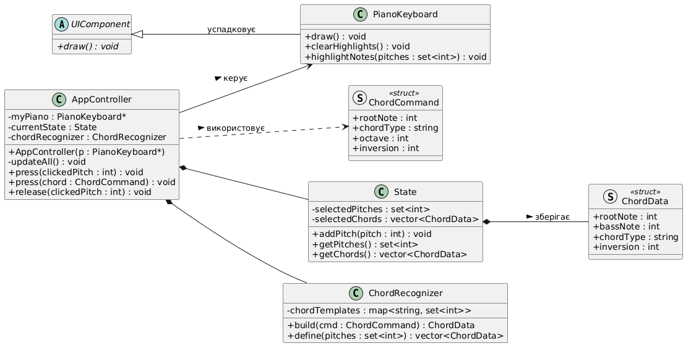
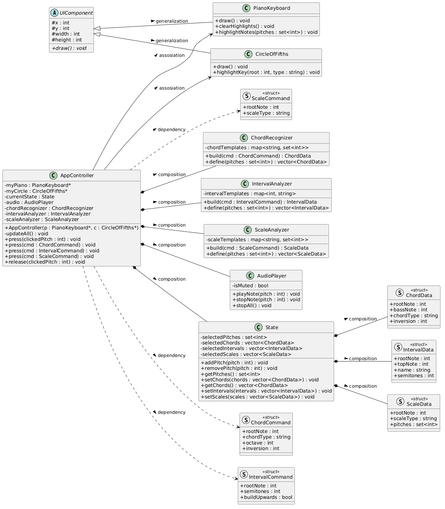
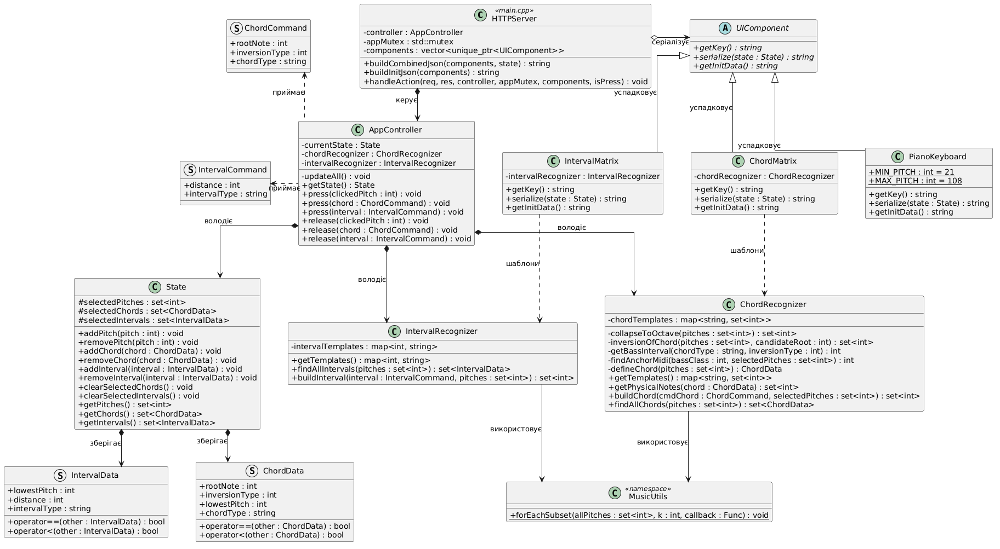
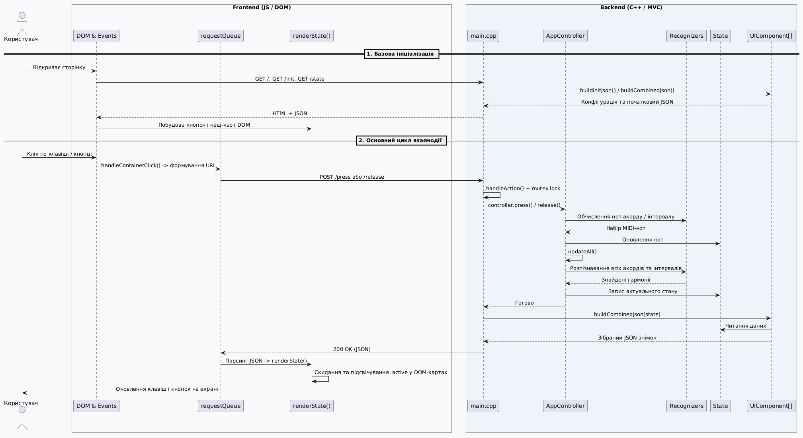

# Project_notesRecognising

Проект "Навчальна програма з музичної теорії"

Звіт №1 (перша лабораторна)

На даний момент у форматі проекту частково виконано такі вимоги до лабораторної 1:
Класів: 5 (планується на даний момент: 8)
Полів: 6 (планується на даний момент: >15)
Нетривіальних методів: 9 (планується на даний момент: >20)
Ієрархій успадкування: 1 (планується на даний момент: 1)
Випадків статичного поліморфізму: 2 (планується на даний момент: >6)
Випадків динамічного поліморфізму: 1 (на даний момент лише формально) (планується на даний момент: 4>)

Деталі архітектури: проект побудований за принципом MVC : Model - State, View - UIComponent, Controller - Controller. Поточна стадія: MVP, розпізнавання акордів з нот, побудова акордів.

UML-діаграма реалізованої на даний момент архітектури:

Приблизна UML-діаграма запланованої до реалізації на даний момент архітектури:

# Звіт №2 (перша, друга лабораторні)

## Опис реалізованої архітектури

Проєкт побудовано за клієнт-серверною архітектурою з чітким розподілом відповідальності (Separation of Concerns) між обчислювальним C++-бекендом та реактивним web-інтерфейсом. Взаємодія клієнта з вбудованим HTTP-сервером (`cpp-httplib`) організована в стилі REST API, який передає дані у форматі JSON. Оскільки сервер обробляє запити в багатопотоковому режимі, доступ до контролера та моделі захищено за допомогою потокобезпечної RAII-синхронізації через `std::mutex` та `std::lock_guard`.

Внутрішнє ядро бекенду реалізує патерн **MVC** та працює за принципом **Single Source of Truth**:
* Класи-рекогнайзери (`ChordRecognizer`, `IntervalRecognizer`) виконують комбінаторний аналіз множини нот та обчислюють дані, на основі яких формуються поля моделі `State`.
* Класи-нащадки `UIComponent` реалізують поліморфну серіалізацію (патерн **Adapter**), збираючи відповідні JSON-фрагменти для браузера.
* `AppController` інкапсулює бізнес-логіку, приймає об'єкти-команди (**DTO**) та забезпечує узгоджене оновлення стану моделі.
* Зв'язується все у `main.cpp`, який виконує роль **Front Controller**: приймає та парсить HTTP-запити, по черзі викликає методи контролера й адаптерів `UIComponent` та відправляє актуальний знімок стану в браузер.

Web-інтерфейс написано на JavaScript, який через кешування DOM-вузлів забезпечує миттєвий доступ до кожної окремої клавіші та кнопки, за допомогою делегування подій компонує URL-запити до сервера, вибудовує їх у послідовний асинхронний ланцюжок промісів та реактивно оновлює стан усіх активних елементів на екрані.

## Виконані вимоги першої лабораторної роботи

* **Класів:** 8 (`UIComponent`, `PianoKeyboard`, `ChordMatrix`, `IntervalMatrix`, `AppController`, `State`, `ChordRecognizer`, `IntervalRecognizer`)
* **Полів:** 22 (з яких 10 — у класах, 12 — у структурах)
* **Нетривіальних методів:** 30 (з яких 26 — у класах, 4 перевантажені оператори порівняння в структурах)
* **Ієрархій успадкування:** 1 (`PianoKeyboard`, `ChordMatrix`, `IntervalMatrix` публічно успадковують абстрактний `UIComponent`)
* **Механізмів динамічного поліморфізму:** 1 (3 віртуальні методи в `UIComponent`, перевизначені в класах-нащадках для поліморфної серіалізації через `std::vector<std::unique_ptr<UIComponent>>`)
* **Механізмів статичного поліморфізму:** 3 (6 перевантажень методів `press`/`release` в `AppController`, 4 перевантаження операторів `==` та `<` у структурах, 1 шаблонна функція `forEachSubset`)

## А також додаткові архітектурні рішення, такі як:

* **Структур:** 4 (`ChordData`, `ChordCommand`, `IntervalData`, `IntervalCommand`)
* **Просторів імен:** 1 (`MusicUtils` у `MusicUtils.h`)
* **Вільних функцій:** 3 (`buildCombinedJson`, `buildInitJson`, `handleAction` у `main.cpp`)
* **Інтеграційний тест на Python:** автоматична перевірка взаємодії інтерфейсу з ядром 
* **Елементи функціонального програмування:**
  * **Шаблонна функція вищого порядку:** `MusicUtils::forEachSubset` (`MusicUtils.h`), яка приймає лямбда-вирази як callback для обробки комбінацій нот.
  * **Лямбда-обробники із замиканням:** реєстрація маршрутів `GET` та `POST` у `main.cpp` із захопленням контексту (`controller`, `appMutex`, `components`) за посиланням.
  * **Чисті функції (`const`-коректність):** методи `serialize(const State&) const` та `getInitData() const` у спадкоємцях `UIComponent`, які не змінюють стан об'єкта.
  * **Асинхронний ланцюжок промісів (Promise Chaining):** послідовна черга `fetch`-запитів у браузері для запобігання гонок станів при швидких кліках.

## Обов'язкові та додаткові вимоги

### Обов'язкові вимоги:
* Проєктування архітектури з дотриманням принципів ООП
* Використання системи контролю версій (Git / GitHub)

### Додаткові вимоги (на додаткові бали):
* **Unit-tests** (модульне тестування логіки розпізнавання на базі `doctest`)
* **Micro-benchmarking** (вимірювання швидкодії ядра через `<chrono>`)
* **Документація Doxygen** (автогенерація документації та графів залежностей)
* **Патерни програмування, а саме:**
  * **MVC (Model — View — Controller):** відокремлення музичної бізнес-логіки від мережевого шару та відображення; модель пов'язана з представленням через `AppController`.
  * **Adapter / Strategy (поліморфна серіалізація):** родина класів `UIComponent` адаптує єдиний об'єкт `State` у різні JSON-представлення для кожного віджета інтерфейсу.
  * **Data Transfer Object (DTO):** структури `ChordCommand` та `IntervalCommand` інкапсулюють вхідні параметри команди з інтерфейсу, відокремлюючи їх від внутрішніх моделей `ChordData` та `IntervalData`.
  * **Single Responsibility Principle:** кожен клас відповідає виключно за свою зону (зберігання стану, аналіз акордів, аналіз інтервалів або серіалізація конкретного компонента).
  * **Single Source of Truth:** клас `State` є єдиним джерелом істини для всього додатку; при цьому всередині самої моделі первинними є саме натиснуті ноти (`selectedPitches`) — при натисканні акорду чи інтервалу спочатку обчислюються фізичні ноти, а вже з них заново перераховуються активні акорди та інтервали, що повністю виключає розсинхронізацію стану.
  * **Потокобезпека (RAII):** захист спільного стану `AppController` від одночасних HTTP-запитів за допомогою `std::mutex` та `std::lock_guard`.

## Діаграма архітектури програми:

## Діаграма послідовності (Sequence Diagram)

# Фінальний звіт:
## Додано:
* **Нейромережу basicPitch:** файл basicPitch.py приймає файл .mp3 та транскрибує його на ноти, які потім грає плеєр.
* **Класи AudioTranscriber та AudioPlayer:** AudioTranscriber запускає нейромережу, AudioPlayer опрацьовує отримані ноти (принцип SRP та синхронізацію не порушено - усі ноти, що бачить користувач, у цей же момент знаходяться у State, таким чином можна чітко відслідковувати музичні закономірності)
* **Веб-плеєр у браузері:** звуки генеруються безпосередньо браузером, доступні два режими - піаніно та орган.
* **Звіт по використанню ШІ:** описано задачі у яких використовувався штучний інтелект, в яких він не використовувався, отриманий досвід та кращі знайдені практики по роботі з ШІ. Також наведено промпти, за допомогою яких агент Antigravity перебудував консольну версію програми на веб-інтерфейс.

### Усі основні вимоги виконано, програма має статус MVP. Подальші зміни будуть стосуватися розширення асортименту музичних структур, виправлення невеликих незручностей у застосуванні та включання нових можливостей.